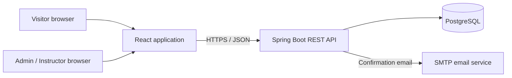

# Mini Workshop Booking System — Software Architecture

| Document information | Value |
|---|---|
| Project | Mini Workshop Booking System |
| Document | Software Architecture Proposal |
| Version | 1.0 |
| Status | Approved |
| Requirements baseline | `requirements.md`, PRD version 1.0 |

## 1. Architecture overview

The system uses a simple, single-deployment architecture. A React single-page application calls a Java 21 and Spring Boot REST API. The API applies authentication, authorization, validation, business rules, and persistence through PostgreSQL. The backend sends booking confirmation email through the configured SMTP service.

The backend is a modular monolith organized by feature. It is not divided into microservices and does not require a message broker.



## 2. Components and responsibilities

### React application

- Provides public workshop listing, detail, and registration flows.
- Provides protected Admin workshop-management and participant views.
- Provides Instructor views limited to assigned workshops and their participants.
- Uses API responses for status and remaining-capacity display; client-side checks do not replace backend enforcement.

### Spring Boot REST API

- Exposes versioned REST endpoints and validates requests.
- Applies authentication and role-based authorization.
- Enforces workshop, registration, duplicate, capacity, and deletion rules.
- Persists data through repositories and coordinates email notifications.
- Returns consistent API errors for invalid, unauthorized, missing, and conflicting requests.

### PostgreSQL

- Stores staff accounts, workshops, registrations, and pending confirmation email records.
- Enforces relationships, duplicate-registration prevention, and workshop deletion restrictions through database constraints.

### SMTP service

- Delivers the booking confirmation email after registration has committed.
- Uses a test SMTP environment during development. Credentials remain in external configuration.

## 3. Backend package structure

Use the Java base package `com.example.workshopbooking` (replace it with the final organization-specific package before implementation).

```text
src/main/java/com/example/workshopbooking/
├── config/           Spring Security and application configuration
├── common/           Shared API error response and exception handling
├── auth/
│   ├── controller/   Login, logout, and current-user endpoints
│   ├── service/      Authentication logic
│   ├── repository/   Account queries
│   ├── entity/       Account and role
│   └── dto/          Authentication request/response types
├── workshop/
│   ├── controller/   Public and Admin workshop endpoints
│   ├── service/      Workshop rules and operations
│   ├── repository/   Workshop persistence and queries
│   ├── entity/       Workshop
│   └── dto/          Workshop request and response types
├── registration/
│   ├── controller/   Public booking and participant-list endpoints
│   ├── service/      Registration and capacity rules
│   ├── repository/   Registration queries
│   ├── entity/       Registration
│   └── dto/          Registration and participant types
└── notification/
    ├── service/      Confirmation email creation and delivery
    └── entity/       Email outbox record
```

Controllers own HTTP concerns, services enforce business rules, and repositories handle database access. Organizing by feature keeps related code together while preserving clear responsibilities.

## 4. Frontend folder structure

```text
src/
├── app/                  Application setup and route definitions
├── features/
│   ├── workshops/        Public listing and workshop details
│   ├── registration/     Visitor registration flow
│   ├── admin/            Admin workshop and participant screens
│   └── instructor/       Assigned workshops and participants
├── shared/
│   ├── api/              REST client and shared error handling
│   ├── components/       Reusable UI components
│   └── types/            Shared frontend data types
└── styles/               Global styles
```

Keep screens and behavior grouped by feature. Begin with React's built-in state tools; introduce a separate state-management library only if project needs justify it.

## 5. Data model

| Entity | Important fields | Relationships and rules |
|---|---|---|
| `Account` | Email, password hash, display name, role (`ADMIN` or `INSTRUCTOR`), active flag | One instructor account may be assigned to many workshops. No visitor accounts. |
| `Workshop` | Title, description, start/end instants, location, maximum participants, instructor account | Belongs to one instructor and has many registrations. |
| `Registration` | Workshop, participant name, normalized email, optional phone, registration time | Belongs to one workshop. Unique `(workshop_id, normalized_email)`. Visitor identity is stored with the registration. |
| `EmailOutbox` | Registration reference, message data, delivery status, attempt count, timestamps, last error | One confirmation record per registration; tracks pending delivery and retries. |

Store the maximum participant count and calculate remaining seats as `maximum participants - registration count`; do not maintain a second mutable seat counter. Use a restrictive foreign key from registrations to workshops so a workshop with registrations cannot be deleted.

Store workshop start and end times as unambiguous instants. Use the configured training-center time zone, `Asia/Phnom_Penh` (UTC+7), for backend status and registration calculations and display workshop times in that time zone.

### Workshop status rule

Status is calculated by the system using the configured `Asia/Phnom_Penh` time zone and is not an Admin-editable field:

1. `COMPLETED` when current time reaches or passes the workshop end time.
2. `FULL` when the workshop has not ended and registration count reaches maximum capacity.
3. Otherwise `OPEN`.

This gives completion precedence over capacity status and avoids status drift. Registration is rejected once current time reaches the workshop start time, independently of displayed status. As a result, an `OPEN` workshop may have started but not yet ended; its displayed status remains `OPEN`, while registration is rejected.

## 6. REST API

All endpoints use JSON and the `/api/v1` prefix. Public workshop responses must not expose participant information.

| Method and route | Access | Purpose |
|---|---|---|
| `GET /api/v1/workshops` | Public | Browse workshops and their status/capacity |
| `GET /api/v1/workshops/{id}` | Public | View workshop details |
| `POST /api/v1/workshops/{id}/registrations` | Public | Register a visitor |
| `POST /api/v1/auth/login` | Public | Authenticate Admin or Instructor |
| `POST /api/v1/auth/logout` | Authenticated | End the current session |
| `GET /api/v1/auth/me` | Authenticated | Return current account and role |
| `GET /api/v1/admin/workshops` | Admin | View all workshops |
| `POST /api/v1/admin/workshops` | Admin | Create a workshop |
| `PUT /api/v1/admin/workshops/{id}` | Admin | Edit a workshop |
| `DELETE /api/v1/admin/workshops/{id}` | Admin | Delete a workshop with no registrations |
| `GET /api/v1/admin/workshops/{id}/registrations` | Admin | View participants for a workshop |
| `GET /api/v1/instructor/workshops` | Instructor | View only workshops assigned to the current instructor |
| `GET /api/v1/instructor/workshops/{id}/registrations` | Assigned instructor | View participants for that workshop |

Use consistent errors: `400` for invalid input, `401` for unauthenticated requests, `403` for insufficient permission, `404` for missing resources, and `409` for duplicate registration, full or started workshops, or deletion blocked by registrations.

For a booking, use the configured `Asia/Phnom_Penh` time zone to determine whether the workshop start time has been reached. Reject registration at or after the start instant, independently of displayed status. Perform availability checks and save the registration in one transaction while locking the workshop row. This prevents concurrent bookings from exceeding capacity. The database unique constraint prevents duplicate registrations even if duplicate requests race.

## 7. Authentication and authorization

Use Spring Security with server-side sessions and secure cookies. A browser session avoids exposing bearer tokens to frontend JavaScript and does not require a token-refresh design.

- Store only password hashes using a Spring Security password encoder.
- Require authentication for Admin and Instructor pages and API routes.
- Enforce roles in the API; frontend route hiding is not authorization.
- Verify instructor ownership in backend queries before returning workshops or participants.
- Use HTTPS, `HttpOnly`, `Secure`, and appropriate `SameSite` cookie settings. Protect state-changing requests against CSRF.
- Prefer serving the React application and API through the same site. If separate origins are required, allow only the exact frontend origin and configure credentialed cookies and CSRF handling accordingly.
- Staff accounts are provisioned by an administrator or operator; there is no public staff registration.

## 8. Confirmation email workflow

Use a PostgreSQL outbox so email delivery can be retried without adding a broker or separate service.

1. Validate the registration and check the workshop.
2. In one database transaction, lock the workshop, check availability and duplicates, save the registration, and create a pending email record.
3. Commit the transaction. The booking is successful only after commit.
4. A scheduled worker in the Spring Boot application sends pending messages through SMTP.
5. Mark successful messages as sent; retry temporary failures and record the final error after retries are exhausted.

The confirmation contains participant name, workshop title, date/time displayed in `Asia/Phnom_Penh`, location, and a confirmation message. A delivery retry may occasionally duplicate an email if SMTP accepted the first send but its acknowledgement was lost; registration remains valid.

## 9. Testing strategy

Use JUnit 5 and Mockito for backend unit tests. Map coverage to functional requirements and acceptance criteria.

- **Service unit tests:** workshop validation, registration eligibility, duplicate and capacity rules, status calculation, deletion restrictions, and notification triggering.
- **Controller and security tests:** validation responses, login/logout, role restrictions, and instructor ownership checks.
- **PostgreSQL integration tests:** unique constraint, restrictive deletion, and concurrent capacity protection. Use a PostgreSQL-backed test environment, including a container-based environment for repeatable tests.
- **Email tests:** mock SMTP delivery and verify retries; verify failed registrations do not enqueue confirmation.
- **Frontend checks:** exercise public registration, protected Admin/Instructor routes, and loading, error, and success states with the frontend testing tools selected for the project.

## 10. Risks and controls

| Risk | Control |
|---|---|
| Concurrent bookings exceed capacity | Lock the workshop row during registration and enforce a unique registration constraint. |
| Authorization exists only in the UI | Enforce roles and instructor ownership in the backend. |
| Workshop status drifts from time or registrations | Calculate status using the approved rule above. |
| SMTP is unavailable or acknowledgement is lost | Use the outbox and retry; account for occasional duplicate delivery. |
| Workshop edits invalidate existing bookings | Reject capacity reductions below current registrations; changes to date/time or instructor do not alter stored registrations. |
| Browser and server interpret workshop time differently | Store unambiguous instants; use `Asia/Phnom_Penh` (UTC+7) for backend calculations and display. |
| Staff provisioning and participant data handling are undefined | Provision staff accounts through an authorized operator and restrict participant data to Admins and assigned Instructors. |

## 11. Approved assumptions and decisions

The following defaults are approved for Version 1:

- Workshop status is system-derived: `COMPLETED` when current time reaches/passes the end instant; otherwise `FULL` if capacity is reached; otherwise `OPEN`. Admins do not set it directly.
- Staff accounts are provisioned by an administrator or operator. Public staff registration is not provided.
- Workshop times are stored as unambiguous instants and displayed using the `Asia/Phnom_Penh` (UTC+7) training-center time zone. Backend status and registration calculations use that configured time zone.
- Registration is rejected when current time reaches or passes the workshop start instant, independently of displayed status.
- An Admin cannot reduce capacity below the current registration count.
- Visitor cancellation and staff registration editing are not included in Version 1.
- A saved booking remains successful when email delivery is delayed; the outbox retries delivery.
- Email addresses are trimmed and case-normalized for duplicate checks.
- Public visitors can see Open, Full, and Completed workshops. Registration is accepted only before the start instant, while capacity remains, and while the workshop has not ended; displayed status alone does not determine eligibility.
- Backend tests include PostgreSQL-backed integration testing using a container-based environment.

These decisions refine the approved PRD without adding new user-facing features. Any later change to these decisions should be reviewed against the PRD and recorded in project documentation.
