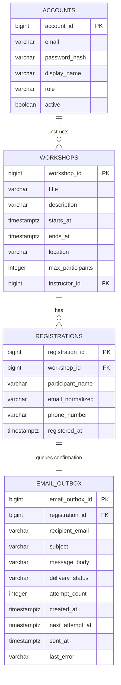

# Mini Workshop Booking System — Database Design

| Document information | Value |
|---|---|
| Project | Mini Workshop Booking System |
| Document | Database Design |
| Status | Ready for owner approval |
| References | `requirements.md` (PRD 1.0) and `architecture.md` (approved) |

This document describes the proposed PostgreSQL structure only. The SQL is illustrative and has not been executed. It does not define application entities, repositories, migrations, or new product features.

## 1. Database Overview

### Database and naming conventions

- Database engine: PostgreSQL.
- Database name: `workshop_booking_db`.
- Use lowercase `snake_case` for table and column names.
- Use plural table names: `accounts`, `workshops`, `registrations`; use `email_outbox` for the outbox table.
- Use `*_id` for key columns and `*_at` for timestamp columns.
- Use explicit `NOT NULL`, `CHECK`, `UNIQUE`, and foreign-key constraints for data rules that can be represented in PostgreSQL.

Each table uses the approved `BIGINT GENERATED BY DEFAULT AS IDENTITY` primary-key strategy.

### Primary key strategy

Each table has a single numeric identity primary key. Foreign keys reference those primary keys. This provides compact, easy-to-understand identifiers for a beginner-scale application. Do not treat these identifiers as authorization tokens or expose them as secrets.

## 2. Entity Relationship Diagram



Cardinality: one Instructor account may instruct zero or many workshops; each workshop has exactly one assigned Instructor. A workshop has zero or many registrations; each registration belongs to exactly one workshop. Each committed successful registration has exactly one outbox record, created in the same transaction. The one-to-one relationship is enforced with a unique `registration_id` in `email_outbox`.

## 3. Table Definitions

In the tables below, “PK” marks a primary key and “FK” identifies a foreign key. Nullable fields are explicitly marked. `IDENTITY` defaults are database-generated.

### `accounts`

Represents Admin and Instructor accounts. Visitors do not have accounts.

| Column | PostgreSQL type | Key | Nullability | Default | Description |
|---|---|---|---|---|---|
| `account_id` | `BIGINT` | PK | NOT NULL | Identity-generated | Account identifier. |
| `email` | `VARCHAR(320)` | UNIQUE | NOT NULL | None | Login email, trimmed and case-normalized before storage. |
| `password_hash` | `VARCHAR(255)` | — | NOT NULL | None | Password hash only; never store a plaintext password. |
| `display_name` | `VARCHAR(200)` | — | NOT NULL | None | Staff member's displayed name. |
| `role` | `VARCHAR(20)` | — | NOT NULL | None | `ADMIN` or `INSTRUCTOR`. |
| `active` | `BOOLEAN` | — | NOT NULL | `TRUE` | Whether the account is active. |

The `role` check allows only the two staff roles defined by the architecture. The Spring Boot service layer must verify that an account has role `INSTRUCTOR` before assigning it to a workshop. The foreign key separately ensures that the account exists; no database trigger is used.

### `workshops`

Workshop status is derived and is not stored as a mutable column, following the approved architecture. Times are stored as instants using `TIMESTAMPTZ`.

| Column | PostgreSQL type | Key | Nullability | Default | Description |
|---|---|---|---|---|---|
| `workshop_id` | `BIGINT` | PK | NOT NULL | Identity-generated | Workshop identifier. |
| `title` | `VARCHAR(200)` | — | NOT NULL | None | Workshop title. |
| `description` | `VARCHAR(5000)` | — | NOT NULL | None | Workshop description, up to 5,000 characters. |
| `starts_at` | `TIMESTAMPTZ` | — | NOT NULL | None | Workshop start instant. |
| `ends_at` | `TIMESTAMPTZ` | — | NOT NULL | None | Workshop end instant. |
| `location` | `VARCHAR(300)` | — | NOT NULL | None | Workshop location. |
| `max_participants` | `INTEGER` | — | NOT NULL | None | Maximum number of registrations. |
| `instructor_id` | `BIGINT` | FK → `accounts.account_id` | NOT NULL | None | Assigned Instructor account. |

### `registrations`

Stores visitor details on each booking; no visitor account or separate participant table is introduced.

| Column | PostgreSQL type | Key | Nullability | Default | Description |
|---|---|---|---|---|---|
| `registration_id` | `BIGINT` | PK | NOT NULL | Identity-generated | Registration identifier. |
| `workshop_id` | `BIGINT` | FK → `workshops.workshop_id` | NOT NULL | None | Workshop being booked. |
| `participant_name` | `VARCHAR(200)` | — | NOT NULL | None | Visitor's full name. |
| `email_normalized` | `VARCHAR(320)` | Part of unique key | NOT NULL | None | Trimmed, case-normalized visitor email. |
| `phone_number` | `VARCHAR(40)` | — | NULL | None | Optional visitor phone number. |
| `registered_at` | `TIMESTAMPTZ` | — | NOT NULL | `CURRENT_TIMESTAMP` | Registration time as an instant. |

### `email_outbox`

Tracks the confirmation message for a successful registration, as specified by the architecture. Store the resolved recipient, subject, and message body directly in the outbox row so retries use the same message content.

| Column | PostgreSQL type | Key | Nullability | Default | Description |
|---|---|---|---|---|---|
| `email_outbox_id` | `BIGINT` | PK | NOT NULL | Identity-generated | Outbox record identifier. |
| `registration_id` | `BIGINT` | FK → `registrations.registration_id`; UNIQUE | NOT NULL | None | Registration whose confirmation is sent; one outbox row per registration. |
| `recipient_email` | `VARCHAR(320)` | — | NOT NULL | None | Normalized visitor email address. |
| `subject` | `VARCHAR(200)` | — | NOT NULL | None | Confirmation email subject. |
| `message_body` | `VARCHAR(10000)` | — | NOT NULL | None | Confirmation content, up to 10,000 characters. |
| `delivery_status` | `VARCHAR(20)` | — | NOT NULL | `'PENDING'` | Delivery state: `PENDING`, `SENT`, or `FAILED`. |
| `attempt_count` | `INTEGER` | — | NOT NULL | `0` | Number of delivery attempts. |
| `created_at` | `TIMESTAMPTZ` | — | NOT NULL | `CURRENT_TIMESTAMP` | Time the pending message was created. |
| `next_attempt_at` | `TIMESTAMPTZ` | — | NOT NULL | `CURRENT_TIMESTAMP` | Earliest time a pending message may be retried. |
| `sent_at` | `TIMESTAMPTZ` | — | NULL | None | Time the message was successfully sent. |
| `last_error` | `VARCHAR(2000)` | — | NULL | None | Most recent delivery failure detail; must not contain credentials. |

Configure retry policy in external Spring Boot configuration, not in an additional database table. Suggested property names are `email.outbox.max-attempts` (default `5` total delivery attempts) and `email.outbox.retry-interval` (default `PT5M`, a fixed 5-minute interval). On a transient delivery failure, increment `attempt_count` and set `next_attempt_at` to the current time plus the configured interval. After the configured limit is reached, set `delivery_status` to `FAILED` and retain the last error. A permanent delivery failure may transition directly to `FAILED`. Successful delivery sets `delivery_status` to `SENT` and records `sent_at`. Failed rows are not automatically deleted; retain them for operational review until an authorized retention cleanup is performed. The organization may later set a formal retention period without changing the table structure.

## 4. Constraints

### Unique constraints

- `accounts`: unique normalized email so a staff login identifies one account.
- `registrations`: `UNIQUE (workshop_id, email_normalized)` prevents the same normalized email from registering twice for the same workshop (BR-07).
- `email_outbox`: `UNIQUE (registration_id)` limits each successful registration to one confirmation outbox record.

### Foreign keys and deletion behavior

- `workshops.instructor_id` references `accounts.account_id` with `ON DELETE RESTRICT`; Spring Boot service-layer validation ensures the account role is `INSTRUCTOR` before assignment.
- `registrations.workshop_id` references `workshops.workshop_id` with `ON DELETE RESTRICT`. This prevents deleting workshops with registrations (BR-15).
- `email_outbox.registration_id` references `registrations.registration_id` with `ON DELETE RESTRICT`.
- No cascade deletion is proposed. Account deletion/deactivation policy is not fully specified; `active = FALSE` is available for deactivation without removing account history.

### Check constraints

- Account `role` is `ADMIN` or `INSTRUCTOR`.
- `max_participants > 0` (BR-04).
- `ends_at > starts_at` ensures a positive workshop duration; this is a data-integrity interpretation of required start and end times.
- Account fields (including the password hash), participant, workshop, and outbox subject/body strings are not blank. Application validation trims and lowercases email using Java `Locale.ROOT` before persistence; database checks ensure stored values are already canonical. PostgreSQL checks can enforce simple nonblank and normalization rules, but do not reliably validate all practical email syntax or deliverability. Perform email syntax validation in the application (BR-06).
- `delivery_status` is one of `PENDING`, `SENT`, or `FAILED`; `attempt_count >= 0`. For `SENT`, `sent_at` must be non-null; for unsent states, `sent_at` must be null.

### Capacity reduction rule

A simple `CHECK` constraint cannot compare `max_participants` with the registration count in another table. Enforce this in one transaction: lock the workshop row `FOR UPDATE`, count its registrations, reject a new capacity below that count, then update the workshop. Registration uses the same workshop-row lock before checking capacity and inserting. This serializes capacity changes against bookings. Capacity changes are made through the Spring Boot service; no database trigger is used.

## 5. Index Design

| Index | Purpose |
|---|---|
| Unique constraint on `accounts(email)` | Finds staff accounts for login and prevents duplicate canonical email identities. |
| `workshops(instructor_id)` | Finds workshops assigned to an Instructor. PostgreSQL does not automatically create an index on the referencing foreign-key column. |
| `workshops(starts_at)` | Supports chronological workshop listing and time-window queries. Status itself is derived and is not indexed. |
| Unique index on `registrations(workshop_id, email_normalized)` | Enforces duplicate prevention and supports lookup of a visitor's registration for a workshop. It also supports participant lookup by workshop. |
| `registrations(workshop_id, registered_at)` | Supports viewing a workshop's participants ordered by registration date. Add only if that sort is used; the unique index above does not cover this ordering. |
| Partial index on `email_outbox(next_attempt_at)` for `delivery_status = 'PENDING'` | Helps the scheduled sender find due pending email rows in retry-time order. |

Do not add indexes for every column. Reassess indexes against actual query plans and data volume after implementation.

## 6. Workshop Status and Time Handling

- Store `starts_at` and `ends_at` as `TIMESTAMPTZ`, representing unambiguous instants.
- Interpret and display workshop times using the configured `Asia/Phnom_Penh` time zone (UTC+7). This also applies to backend status and registration calculations, as approved in the architecture.
- The PRD's required workshop `Status` is provided as a derived value in application/API responses; it is not a persisted database column.
- Calculate displayed status at read time; do not persist a status value:
  1. `COMPLETED` when current time reaches or passes `ends_at`.
  2. `FULL` when the workshop has not ended and registration count is at least `max_participants`.
  3. `OPEN` otherwise.
- Independently reject registration when current time reaches or passes `starts_at`, even if displayed status is `OPEN`.
- A workshop that has started but not ended and has spare capacity can therefore display `OPEN`, while registration is rejected. This follows the approved architecture's distinction between status and booking eligibility.

Since instants are compared as instants, the application should use the configured `Asia/Phnom_Penh` zone when interpreting local workshop input and when producing local display values, then compare the resulting instants. PostgreSQL session time zone should not be relied upon to define stored instants.

## 7. Concurrent Registration

Registration processing should run in a database transaction:

1. Select and lock the target workshop row using `SELECT ... FOR UPDATE`.
2. Check that current time is before `starts_at`, the workshop has not ended, and registrations are below `max_participants`.
3. Check for an existing normalized email registration.
4. Insert the registration and its pending outbox row.
5. Commit.

Concurrent booking transactions for the same workshop wait on the same row lock. Each checks the count after the previous transaction commits, so the capacity check cannot allow an overbooking. The unique constraint on `(workshop_id, email_normalized)` remains the final defense against duplicate requests, including races. If a unique violation occurs, the application should return the duplicate-registration conflict described by the architecture.

Capacity changes must lock the same workshop row before comparing the proposed capacity to the current registration count. This prevents a capacity update from racing with a new booking.

## 8. Sample SQL

The following PostgreSQL DDL is illustrative only. It has not been executed and is not a migration.

```sql
CREATE TABLE accounts (
    account_id BIGINT GENERATED BY DEFAULT AS IDENTITY PRIMARY KEY,
    email VARCHAR(320) NOT NULL UNIQUE
        CHECK (email <> '' AND email = lower(btrim(email))),
    password_hash VARCHAR(255) NOT NULL CHECK (btrim(password_hash) <> ''),
    display_name VARCHAR(200) NOT NULL CHECK (btrim(display_name) <> ''),
    role VARCHAR(20) NOT NULL CHECK (role IN ('ADMIN', 'INSTRUCTOR')),
    active BOOLEAN NOT NULL DEFAULT TRUE
);

CREATE TABLE workshops (
    workshop_id BIGINT GENERATED BY DEFAULT AS IDENTITY PRIMARY KEY,
    title VARCHAR(200) NOT NULL CHECK (btrim(title) <> ''),
    description VARCHAR(5000) NOT NULL CHECK (btrim(description) <> ''),
    starts_at TIMESTAMPTZ NOT NULL,
    ends_at TIMESTAMPTZ NOT NULL,
    location VARCHAR(300) NOT NULL CHECK (btrim(location) <> ''),
    max_participants INTEGER NOT NULL CHECK (max_participants > 0),
    instructor_id BIGINT NOT NULL,
    CONSTRAINT fk_workshops_instructor
        FOREIGN KEY (instructor_id)
        REFERENCES accounts (account_id)
        ON DELETE RESTRICT,
    CONSTRAINT ck_workshops_positive_duration
        CHECK (ends_at > starts_at)
);

CREATE INDEX ix_workshops_instructor_id
    ON workshops (instructor_id);

CREATE INDEX ix_workshops_starts_at
    ON workshops (starts_at);

CREATE TABLE registrations (
    registration_id BIGINT GENERATED BY DEFAULT AS IDENTITY PRIMARY KEY,
    workshop_id BIGINT NOT NULL,
    participant_name VARCHAR(200) NOT NULL
        CHECK (btrim(participant_name) <> ''),
    email_normalized VARCHAR(320) NOT NULL,
    phone_number VARCHAR(40)
        CHECK (phone_number IS NULL OR btrim(phone_number) <> ''),
    registered_at TIMESTAMPTZ NOT NULL DEFAULT CURRENT_TIMESTAMP,
    CONSTRAINT ck_registrations_email_normalized
        CHECK (email_normalized <> '' AND email_normalized = lower(btrim(email_normalized))),
    CONSTRAINT uq_registrations_workshop_email
        UNIQUE (workshop_id, email_normalized),
    CONSTRAINT fk_registrations_workshop
        FOREIGN KEY (workshop_id)
        REFERENCES workshops (workshop_id)
        ON DELETE RESTRICT
);

CREATE INDEX ix_registrations_workshop_registered_at
    ON registrations (workshop_id, registered_at);

CREATE TABLE email_outbox (
    email_outbox_id BIGINT GENERATED BY DEFAULT AS IDENTITY PRIMARY KEY,
    registration_id BIGINT NOT NULL UNIQUE,
    recipient_email VARCHAR(320) NOT NULL
        CHECK (recipient_email <> '' AND recipient_email = lower(btrim(recipient_email))),
    subject VARCHAR(200) NOT NULL CHECK (btrim(subject) <> ''),
    message_body VARCHAR(10000) NOT NULL CHECK (btrim(message_body) <> ''),
    delivery_status VARCHAR(20) NOT NULL DEFAULT 'PENDING'
        CHECK (delivery_status IN ('PENDING', 'SENT', 'FAILED')),
    attempt_count INTEGER NOT NULL DEFAULT 0 CHECK (attempt_count >= 0),
    created_at TIMESTAMPTZ NOT NULL DEFAULT CURRENT_TIMESTAMP,
    next_attempt_at TIMESTAMPTZ NOT NULL DEFAULT CURRENT_TIMESTAMP,
    sent_at TIMESTAMPTZ,
    last_error VARCHAR(2000),
    CONSTRAINT ck_email_outbox_sent_at
        CHECK (
            (delivery_status = 'SENT' AND sent_at IS NOT NULL)
            OR (delivery_status IN ('PENDING', 'FAILED') AND sent_at IS NULL)
        ),
    CONSTRAINT fk_email_outbox_registration
        FOREIGN KEY (registration_id)
        REFERENCES registrations (registration_id)
        ON DELETE RESTRICT
);

CREATE INDEX ix_email_outbox_pending_next_attempt_at
    ON email_outbox (next_attempt_at)
    WHERE delivery_status = 'PENDING';
```

The retry limit and interval are application configuration, not database rows. Failed messages remain stored; do not add an outbox cleanup job unless an approved retention policy defines it. The capacity-reduction check is deliberately not represented by a cross-table `CHECK` constraint; enforce it with the transaction/row-lock rule described above.

## 9. Data Integrity and Security Considerations

- Store password hashes only, never plaintext passwords. Use the Spring Security password encoder specified by the architecture.
- Keep database credentials outside source control, as required by NFR-08.
- Use parameterized database access through the application persistence layer; do not concatenate visitor input into SQL.
- Validate names, email, date/time, and other inputs in the application. Database constraints provide a second line of defense for invariants.
- Restrict participant details to Admins and Instructors assigned to the corresponding workshop, as required by the PRD and architecture.
- Keep phone number nullable because it is optional; keep participant name and email required.
- Restrict hard deletion of workshops with registrations. Do not cascade-delete registration or outbox records.
- Do not store visitor accounts, payment data, SMS data, waitlists, or other out-of-scope concepts.
- Avoid putting SMTP credentials or sensitive connection information in the outbox fields or `last_error`.

## Finalized Design Decisions

- Database name is `workshop_booking_db`; every table uses `BIGINT GENERATED BY DEFAULT AS IDENTITY` primary keys.
- Staff and visitor emails are trimmed and lowercased with Java `Locale.ROOT` before storage. Canonical values are stored in lowercase; exact-value unique constraints prevent duplicates. The SQL checks reject noncanonical values.
- Workshop assignment checks the account role in the Spring Boot service layer. No database trigger is used.
- Retry defaults are configurable through `email.outbox.max-attempts` (5 total attempts) and `email.outbox.retry-interval` (`PT5M`). Once attempts are exhausted, the row becomes `FAILED` with its latest error; permanent failures may fail immediately. Failed rows are retained for operational review and are not automatically purged; any later cleanup must follow an approved retention policy.
- Maximum field lengths and blank-string checks are documented above and repeated in the illustrative DDL. Application validation remains responsible for email syntax and deliverability.
- Workshop status remains derived and unpersisted, following the approved architecture. No separate status column is added.
